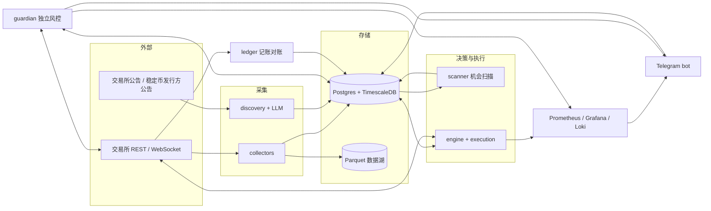
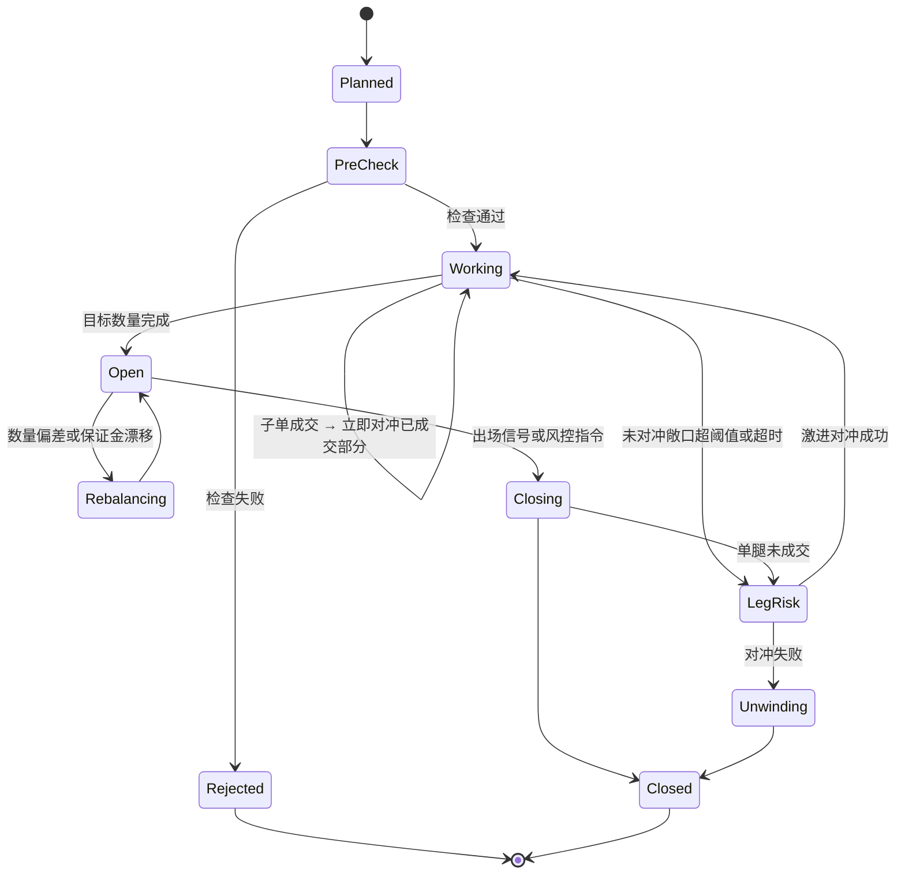

# 结构性小容量优势：开发方案

- 版本：v1.1
- 日期：2026-10-30
- 状态：草案，待评审
- 取代：原 `docs/requirements.md`（约束 × 需求决策系统，方向已废弃，旧 `system/` 代码不再沿用）

**v1.1 修订要点（相对 v1）：**

1. **先验证、后工程**：新增 G0（经济性）和 1～2 周的快速研究（Python + 免费数据），G1 提前到约第 3 周；Go 平台在 G1 通过后才大规模开发。研究期的 Python 原型用完即弃，"决策代码只有一份 Go"从 G1 之后开始执行。
2. **小资金、单交易所起步**：一期先只接 1 家交易所、只跑 1 个变体；第二、三家交易所和其他变体放到实盘稳定之后。
3. **基础设施分阶段启用**（6.6.0 节）：研究期只要本地 Mac + 一台便宜 VPS 跑采集脚本；VPS B、Grafana 全套、Loki 等在上实盘前后再加；风控标志与心跳改用 Postgres，不再引入 Redis。
4. **G1 标准修正**：必须按实际要跑的变体评估；比较基准包含被动可得的同类收益；体制分析（R10）成为通过条件；R1 改为"可执行费率地图"。
5. **发现层降级**：一期只做元数据变更检测 + 公告标题关键词告警；LLM 抽取、golden set、审核界面推迟到有第二个策略需要时。
6. **设计漏洞修补**：guardian 与 engine 的仓位所有权协议（14.4 节）；跨所对冲只在一腿已失效时执行；单交易所限额按总资金（含场外）计算；G2 改为与同期回放结果对比。
7. **工作量重估**：按单交易所精简范围重估，并给出不确定性区间。

> 本文是研究与工程方案，不构成投资建议。文中所有费率、阈值、参数、条款数值都只是**起点示例**，必须以交易所当时的官方规则和你自己的研究数据为准。
> 结构性收益普遍带有"平时稳定小赚、偶尔一次大亏"的尾部风险，起步资金应以"能承受全部损失"为上限。

---

## 0. 摘要

| 项 | 内容 |
|---|---|
| 方向 | 不预测涨跌，赚市场结构"让出来"的钱：偏好溢价、被迫交易、规则约束、摩擦成本。容量小到机构不做 |
| 第一个落地 | 加密永续资金费率 / 期现基差 carry：门槛最低、数据完整、API 齐全、可 24 小时全自动 |
| 市场范围 | 一期只做加密市场，**先只接 1 家交易所**。A 股可转债等放到二期，只做备忘（第 10 节） |
| 资金规模 | 个人账户、小资金。规模决定方案做多重：G0 先算清"值不值得做"，资金小时坚持精简版 |
| 后续扩展 | 实盘稳定后再扩展第二家交易所、统一账户、跨所费率差、交割基差等变体，并通过机会管道研究其他加密结构 |
| 横向能力 | "发现层"：一期只做元数据变更检测 + 公告关键词告警；LLM 抽取等有第二个策略需要时再做 |
| 真正的资产 | 研究流程（快速验证、快速放弃）+ 一套够用的执行、风控、账本能力。平台只在机会被验证后才扩建，不为"将来可能用到"提前搭 |
| 技术路线 | 验证期：Python + 免费数据快速研究，原型用完即弃。G1 通过后：Go 为主（采集、策略、模拟器、执行、风控、账本），策略代码只写一份 Go，回测和实盘共用；Python 做后续研究 |
| 推进方式 | G0 经济性 → 快速研究 → G1 → 执行开发 → 模拟盘 G2 → 小资金实盘 G3 → 扩容 G4。不过闸门就停止或转向；资金按闸门逐级爬坡 |
| 工作量 | 到 G1 约 2～3 人周；到"单交易所小资金实盘"约 12～18 人周（全职，含不确定性）。兼职按 ×2～3 估算。扩展和发现层另计 |

---

## 1. 背景与方向决策

### 1.1 放弃的路线

| 路线 | 根本问题 |
|---|---|
| 纯价格 ML/DL（freqtrade / FreqAI） | 信噪比极低；最拥挤的战场；多次试验挑最优造成过拟合；手续费和滑点吃掉微弱优势 |
| 宏观条件监控（约束 × 需求） | 宏观数据全市场共享，没有对手方付钱给你；有效样本极少；条件与价格的关系会随体制改变 |

### 1.2 新方向

**收益不来自预测，而来自市场的规则、约束和参与者的固定行为模式。因为容量太小，大机构懒得做，个人才有机会。**

| | 预测型 | 结构型 |
|---|---|---|
| 赚什么钱 | 比别人更早、更准判断方向 | 别人因规则、约束、偏好主动或被迫让出的钱 |
| 对手方 | 说不清 | 说得清：是谁、为什么愿意付 |
| 收益形态 | 胜率低，靠赚大亏小 | 胜率高、单笔小，有尾部大亏 |
| 与大盘 | 高度相关 | 通常低相关 |
| 怎么消失 | 别人的模型更好 | 资金涌入压平价差，或规则被修改 |

---

## 2. 核心概念与判断标准

### 2.1 四种收益机制

| 机制 | 说明 | 例子 |
|---|---|---|
| 偏好溢价 | 有人愿意为某种体验（加杠杆、彩票型收益）付费 | 永续合约资金费率 |
| 被迫交易 | 有人必须在特定时间做特定交易，不在乎价格 | 强平、指数产品调仓 |
| 规则约束 | 有人看得见机会但不能做 | 机构受合规限制，只能在少数交易所交易主流币，碰不到中小币种和部分交易所的机会 |
| 摩擦成本 | 太麻烦、太琐碎、太小 | 多交易所账户、充提划转、逐条读交易所公告和规则 |

### 2.2 准入六问

任何机会进入开发前，必须在机会卡片（[附录 A](#附录-a机会卡片模板)）里回答清楚：

1. **对手方是谁？** 他为什么愿意或必须付这笔钱？
2. **机构为什么不来？** 是容量、合规，还是太麻烦？
3. **容量多大？** 你的资金放进去会不会自己把价差吃掉？
4. **最坏情况是什么？** 一次最多亏多少，概率大概多大？
5. **它会怎么消失？** 有哪些可观测的衰减信号？
6. **你的成本优势是什么？**

答不清第 1 题的，一律不做。

### 2.3 尾部风险

很多结构性收益本质是"卖保险"：平时每天稳定赚，极端事件（交易所倒闭、连环强平、违约、规则突变）一次亏掉一两年的利润。所以本系统**先设计"怎么死"，再设计"怎么赚"**。

### 2.4 生命周期

```
少数人发现 → 社区传播 → 被产品化（基金、协议、量化团队大规模入场）→ 价差被压平 / 规则修改 → 退役
```

每张机会卡片都有状态：`candidate → researching → paper → live → decaying → retired`。平台的长期目标是让"发现下一个结构"成为常规流程。

### 2.5 设计原则

1. **不预测方向**：对冲型策略的净 delta 必须接近 0；如果以后引入非对冲型策略（如二期的可转债轮动），方向暴露必须有明确的结构性理由和下限保护。
2. **尾部优先**：每个策略先写清楚失败场景和应对，再写收益逻辑。
3. **风控独立**：风控进程与策略进程分离，拥有一票否决和强平权；策略进程挂了，风控照样能平仓。
4. **账本即真相**：每一分钱都能追溯到交易所的原始记录，每天对账。
5. **系统不能提币**：所有 API Key 不开提币权限，跨所划转由人工执行。
6. **LLM 不进加风险回路**：LLM 只产出结构化事件。降风险动作（如下架 → 退出）可以自动生效；加风险动作必须经规则校验或人工审核。
7. **时点正确**：研究只用当时可得的数据，必须包含已下架、已退市品种，避免幸存者偏差。
8. **小步爬坡**：研究 → 模拟 → 小资金 → 扩容，每一步都有闸门。
9. **简单优先**：能用一条规则解决的，不上模型；能人工的低频操作，不急着自动化。
10. **决策代码只有一份**：G1 通过后，策略规则和成本模型只用 Go 实现一次，回测模拟器和实盘引擎调用同一份代码，避免两套实现逐渐不一致。G1 之前的 Python 研究原型是一次性的，只用来做"做不做"的决定；Go 实现完成后用原型的输出做对拍，之后原型归档、不再维护。
11. **先验证、后工程**：任何超过 1 人周的工程投入，都要先有一个闸门证明它服务的机会值得做。

---

## 3. 目标、非目标与成功标准

### 3.1 目标

1. 建成一套可复用的结构性策略平台，支持多交易所、多策略。
2. 让资金费率 carry 策略在小资金实盘上稳定运行，收益与研究预期偏差可解释。
3. 在同一平台上扩展资金效率更高的变体（统一账户、跨所、交割基差）。
4. 建成发现层，持续输出结构化事件和新机会卡片。

### 3.2 非目标（v1 明确不做）

- 方向性预测策略
- 做市、毫秒级高频
- 自动提币、自动跨所划转（系统只给划转建议）
- 面向外部用户的 Web 前台（Telegram + Grafana 足够）
- 管理他人资金
- A 股相关的任何开发（二期备注见第 10 节）
- 实盘稳定（G3）之前：第二家交易所、第二个变体、LLM 发现层

### 3.3 项目级成功标准

- 第一个策略在小资金实盘稳定运行 ≥ 12 周（即 G3 取 12 周），已实现净收益与模拟偏差可逐项解释
- 账本对账零未解释差异
- 无未闭环的严重事故
- 机会管道中至少 2 张卡片通过研究闸门

---

## 4. 机会组合与优先级

| 机会 | 机制 | 自动化 | 数据可得性 | 主要尾部风险 | 优先级 | 所在阶段 |
|---|---|---|---|---|---|---|
| 资金费率 carry（同所：现货多 + 永续空） | 偏好溢价 | 全自动 | 高 | 交易所、强平、稳定币 | **P1** | P0–P5 |
| 统一账户下的 carry | 偏好溢价 | 全自动 | 高 | 同上 + 抵押品折扣调整 | **与上一行二选一作主力，由 G1 决定** | 主力则 P0–P5，否则 P6 |
| 跨所永续费率差 | 偏好溢价 | 全自动 | 高 | 双边强平、划转延迟 | P1 扩展（需第二家交易所） | P6 |
| 交割合约期现基差 | 偏好溢价 | 全自动 | 高 | 交易所 | P1 扩展 | P6 |
| 负费率 carry（借币卖现货 + 永续多） | 偏好溢价 | 自动 | 中（借币额度） | 借币召回、利率飙升 | 可选 | P6 |
| 跨所现货价差 | 摩擦成本 | 半自动 | 中 | 充提卡住、链上拥堵 | 候选 | 只建卡片（第 12 节） |
| 加密指数产品调仓 | 被迫交易 | 半自动 | 中 | 影响太小、预测错误 | 候选 | 只建卡片（第 12 节） |
| Launchpool、空投、交易所活动 | 规则红利 | 手工 | — | 小 | 补充 | 只建卡片，不开发 |
| A 股可转债、指数调样、LOF / QDII 折溢价 | 规则约束、被迫交易、摩擦成本 | 半自动 | 中高 | 信用违约、退市、规则调整 | 二期 | 只做备忘（第 10 节） |

**为什么资金费率排第一**：API 完整、数据可回填、全自动、24 小时市场、反馈周期短（每 8 小时一次结算就能验证一次），最适合用来把平台的执行、风控、账本能力一次性练扎实。即使它本身的收益被压薄，平台能力也能迁移到后续机会上。

**已知现状**：2024 年起，Ethena 等协议把主流币的基差 carry 做成了大规模产品，BTC、ETH 的费率被明显压低。主流币适合用来验证系统，真正的收益更可能来自中小币种、新上线合约和极端行情时段，这些地方的风险也更大。

**必须先回答的矛盾**：高费率最常出现的地方（新上线合约、没有同所现货的永续、流动性薄的中小币种），恰恰是品种池过滤（9.6 节）会排除的地方。所以研究的第一件事不是看原始费率分布，而是看"套上全部可执行条件之后还剩多少净收益"（R1 可执行费率地图）。这个数基本决定 G1。新上线合约作为独立子池单独研究（9.6 节），不混进 v1 品种池。

---

## 5. 总体架构



风控标志（`block_new` / `reduce` / `kill`）、进程心跳和 bot 控制命令都存在 Postgres 的小表里（`risk_flags`、`heartbeats`），需要即时通知时用 `LISTEN/NOTIFY`。一期数据量和频率都很低，不再单独引入 Redis。

上图是完整形态。各组件按 6.6.0 节分阶段启用，一期先只接 1 家交易所。

### 5.1 进程划分

| 进程 | 职责 | 挂掉的影响 | 兜底 |
|---|---|---|---|
| `collector-<venue>` | 合约元数据、资金费、订单簿、OI、借币利率 | 扫描数据变旧 | 数据新鲜度告警；数据过期时引擎禁止开仓 |
| `scanner` | 定时计算机会和预期净收益 | 不产生新机会 | 引擎只维持现有持仓 |
| `engine` | 目标组合 → 执行任务 → 成对执行 | 不再调仓 | guardian 继续监控、可强平 |
| `guardian` | 独立连接交易所，监控限额和风险事件，设置风控标志、执行熔断 | 失去第二道防线 | 引擎检测 guardian 心跳，丢失即禁止开仓；外部 dead-man 告警到手机 |
| `ledger` | 拉取成交、资金费、手续费、利息、划转、强平记录，记账与对账 | 账本滞后 | 对账滞后告警 |
| `discovery` | 一期：抓取公告标题、关键词匹配、告警；后期：LLM 抽取事件、审核队列 | 事件延迟 | 合约元数据变更检测作为下架等事件的冗余来源 |
| `bot` | Telegram 查询与控制命令 | 无法远程操作 | 交易所网页 / App 手工操作，见 runbook |
| 批处理 | 日终对账、研究快照导出、备份 | 当日报表缺失 | 次日补跑 |

以上进程全部用 Go 实现。Python 只用于研究（含 G1 之前的一次性原型）和后期的审核界面（见 6.1 节）。

---

## 6. 技术选型

### 6.1 语言分工

原则：**做决策、长期运行的部分用 Go；研究分析用 Python。G1 之后，策略规则和成本模型只用 Go 写一份，回测和实盘共用这一份。G1 之前用 Python 快速验证，原型不进生产。**

| 部分 | 语言 | 理由 |
|---|---|---|
| 交易所适配器、采集服务 | Go | 同时维护大量 WebSocket 长连接，goroutine 天然适合 |
| 机会扫描、策略规则、成本模型 | Go | 写成纯函数，回测和实盘调用同一份代码 |
| G1 前的快速研究与规则回测 | Python（一次性） | 资金费 8 小时结算一次，按结算粒度做向量化回测即可回答"做不做"；迭代速度最重要 |
| 资金费率回测模拟器（G1 之后） | Go | 与实盘共用策略代码，避免两套实现逐渐不一致；用 Python 原型的输出做对拍 |
| 最小采集脚本（G1 前） | Python 或 Go 均可，单文件 | 只为尽早积累无法回填的预估费率和盘口数据；G1 通过后由正式 collector 取代 |
| 订单管理、成对执行、崩溃恢复 | Go | 静态类型、显式错误处理、`context` 统一超时和取消 |
| 独立风控、熔断 | Go | 同上 |
| 记账对账、Telegram bot | Go | 同上 |
| 发现层（公告抓取 + LLM 抽取） | Go | Anthropic 有官方 Go SDK |
| 探索性研究、报表 | Python | 数据分析生态（Polars、DuckDB、Jupyter）Go 没有对应物 |
| 预期费率模型 | Python 训练，Go 推理 | 模型保持可移植（线性回归、指数加权），系数写进 YAML 给 Go 读 |
| 审核界面（后期，LLM 发现层启用时） | Telegram 按钮优先；不够用再上 Python（Streamlit） | 一期加风险事件很少，Telegram 内联按钮足够 |

不全用 Python 的原因：执行、风控、账本是最需要写扎实的部分，应该用你的主力语言；长期运行服务的类型安全和稳定性也是 Go 更好。
不全用 Go 的原因：探索性研究用 Go 效率很低。另外，二期的 A 股数据和券商接口也只有 Python 版本。
性能方面 Go 已经足够，暂不需要 Rust；将来做做市再评估。

### 6.2 两种语言之间的数据交接

不使用 RPC，只通过三种媒介交换数据：

| 媒介 | 方向 | 内容 |
|---|---|---|
| PostgreSQL | Go 写、Python 读 | 业务数据、市场数据、事件 |
| Parquet | Go 写、Python 读 | 研究快照、原始订单簿、回测输出 |
| YAML（`configs/`） | 人工维护，或由 Python 产出模型系数；Go 读 | 策略参数、风控限额、模型系数 |

约定：
- 表结构只由 `migrations/`（goose，纯 SQL）管理，两种语言都不在代码里建表或改表。
- Parquet 文件的元数据里写入 schema 版本和数据版本，Python 读取时校验。
- Python 产出的模型系数文件必须带上训练数据版本和样本外指标；Go 加载时做强校验，缺字段直接拒绝启动。

### 6.3 Go 技术栈

| 用途 | 选择 | 说明 |
|---|---|---|
| 版本 | Go 最新稳定版 | — |
| 交易所接入 | 自写薄适配器（REST + WebSocket），实现统一的 `venue.Adapter` 接口 | 一期只接 1 家，最多扩到 3 家；需要资金费、统一账户、借币等专有字段；可参考 `adshao/go-binance` 等社区 SDK，以及 ccxt 的 Go 版本（使用前核实成熟度） |
| WebSocket | `coder/websocket` | 对 `context` 友好 |
| HTTP | 标准库 `net/http`，自写签名和限速中间件 | — |
| 限速 | `golang.org/x/time/rate` | 令牌桶，按交易所权重计量 |
| 并发控制 | `context`、`golang.org/x/sync/errgroup` | — |
| 数据库驱动 | `jackc/pgx` v5 | — |
| SQL 代码生成 | `sqlc` | 写 SQL，生成类型安全的 Go 代码 |
| 数据库迁移 | `pressly/goose` | 纯 SQL 迁移，两种语言共用 |
| 金额与数量 | `shopspring/decimal` | 账本、下单数量、价格一律用 decimal；`float64` 只用于统计和指标计算 |
| 配置 | `knadh/koanf` + `go-playground/validator` | 启动时强校验 |
| 日志 | 标准库 `log/slog`（JSON） | 一期写本地文件 / Docker 日志；扩容阶段再接 Loki |
| 指标 | `prometheus/client_golang` | — |
| Parquet | `parquet-go/parquet-go` | — |
| 定时任务 | `robfig/cron` v3 | — |
| ID | `oklog/ulid` | — |
| CLI | `spf13/cobra` | 回测、运维命令 |
| Telegram | `go-telegram/bot` | — |
| LLM | `anthropics/anthropic-sdk-go` | — |
| 测试 | 标准库 `testing` + `testify`；`pgregory.net/rapid`（属性测试）；内置 fuzzing；`testcontainers-go`（集成测试启动 Postgres） | 见第 18 节 |
| 代码质量 | `golangci-lint`、`go vet`、所有测试带 `-race` | — |

### 6.4 Python 技术栈（`research/`、`review/`）

| 用途 | 选择 |
|---|---|
| 包管理 | uv（一期只有 `research`；启用审核界面时再改成 workspace） |
| 数据处理 | Polars、DuckDB |
| 研究与建模 | Jupyter、Plotly、statsmodels、scikit-learn |
| 数据库 | psycopg 3（研究只读；审核界面只写审核结果） |
| 审核界面（后期） | Streamlit，仅在 Telegram 按钮不够用时 |
| 测试与质量 | pytest、ruff、mypy |

### 6.5 基础设施

| 领域 | 选择 | 理由 | 备选 / 何时切换 |
|---|---|---|---|
| 业务数据库 | PostgreSQL 16 + TimescaleDB | 账本要 ACID，时序要压缩和连续聚合，一个库覆盖两类需求，单人运维负担最小 | 订单簿数据量过大时把原始快照迁到 ClickHouse |
| 研究存储 | Parquet + DuckDB / Polars | 研究可复现、读取快、与生产库隔离 | — |
| 原始订单簿 | Parquet，按 `venue/date` 分区，同步到 Cloudflare R2 | 数据量大、只追加、按需回放 | 付费历史数据：Tardis.dev（采购规则见 8.5.4） |
| 进程间通信 | Postgres 小表 + `LISTEN/NOTIFY` | 少一个有状态服务；一期频率很低 | 确有高频需求时再引入 Redis |
| 监控 | 一期：Telegram 告警 + 关键指标日报；扩容阶段：Prometheus + Grafana + Loki | 单人运维先保证告警可靠，仪表盘可以晚一点 | — |
| 告警 | 进程内规则直接推 Telegram（后期改用 Grafana Alerting）；外部 dead-man 用 Cloudflare Workers + Cron Triggers | 与服务器完全独立，两台服务器全挂也能收到告警 | healthchecks.io |
| LLM | Claude API：分类用 `claude-haiku-5-5`，抽取用 `claude-sonnet-5-5`，复杂条款解读用 `claude-opus-5-5`；JSON Schema 结构化输出；Batch API + 提示缓存控制成本 | 公告和条款阅读量大，结构化输出可直接入库 | — |
| 部署 | 研究期一台便宜 VPS；实盘前扩到两台海外 VPS（东京或新加坡）+ Docker Compose；Go 服务用多阶段构建打成 distroless 镜像；详见 6.6 节 | 秒级策略对延迟不敏感，但需要固定出口 IP 和网络稳定 | — |
| 内网与访问 | Tailscale（或 WireGuard）连接两台 VPS；Cloudflare Tunnel + Access 暴露 Grafana 和审核界面 | 服务器不开放任何公网入站端口 | VPN / SSH 隧道 |
| CI | GitHub Actions，Go 和 Python 两条流水线 | — | — |
| 密钥 | `.env` 不入库；sops + age 或 1Password CLI | — | — |

### 6.6 部署与基础设施

#### 6.6.0 分阶段启用

下面 6.6.1～6.6.8 描述的是完整形态。小资金阶段按需启用，不提前搭：

| 阶段 | 启用的组件 | 大致月费 |
|---|---|---|
| 研究期（G0～G1） | 本地 Mac（研究）+ 一台便宜 VPS（固定 IP，跑最小采集脚本，数据写 Parquet 并同步到 R2） | 5～15 美元 |
| 执行开发与模拟盘（G1～G2） | VPS A 升配：Postgres + TimescaleDB、collector、scanner、engine、ledger、bot、guardian（先同机）；dead-man Worker；Tailscale；Telegram 告警 | 30～60 美元 |
| 小资金实盘（G2～G3） | 加 VPS B（另一家服务商）并把 guardian 迁过去；备份到 R2 并做一次恢复演练 | 40～80 美元 |
| 扩容（G3 之后） | Prometheus + Grafana + Loki、Cloudflare Tunnel + Access、第二家交易所、LLM 发现层 | 见 6.6.8 |

guardian 在实盘前必须迁到独立的 VPS B：模拟盘阶段同机部署只是为了少维护一台机器，不能带进实盘。

#### 6.6.1 总体布局

```
Cloudflare
├── R2：原始盘口、历史数据包、Tardis 样本、数据库备份
├── Tunnel + Access：Grafana、审核界面的唯一入口
├── Workers + Cron Triggers：外部心跳监控 → Telegram
└── DNS

VPS A：主机（东京 / 新加坡，固定 IP，已加入交易所 API 白名单）
└── collector、scanner、engine、ledger、discovery、bot、Postgres + TimescaleDB

VPS B：看门人（另一家服务商，固定 IP，已加入交易所 API 白名单）
└── guardian、Prometheus、Grafana、Loki

两台 VPS 之间：Tailscale 内网（guardian 通过内网读写 A 上 Postgres 的风控标志表，Prometheus 通过内网抓取 A 的指标）
本地 Mac：研究环境，从 R2 同步 Parquet，不连生产数据库跑大查询
```

#### 6.6.2 服务器

| | VPS A：主机 | VPS B：看门人 |
|---|---|---|
| 配置（起步） | 4 核 / 16 GB 内存 / 300 GB 以上 NVMe | 1～2 核 / 2～4 GB 内存 / 50 GB |
| 进程 | 采集、扫描、引擎、记账、发现层、bot、Postgres | guardian、Prometheus、Grafana、Loki |
| 服务商 | Vultr、DigitalOcean、Linode 等的东京或新加坡机房；追求最稳定可选 AWS 东京（更贵，出网流量另计） | 与 A **不同**的服务商 |
| 大致月费 | 50～100 美元 | 10～20 美元 |

选址规则：
1. 东京或新加坡，靠近主要交易所。秒级策略对延迟不敏感，选址主要看网络稳定性。
2. 不用中国内地机房，不用美国机房（Binance、Bybit 等交易所会屏蔽美国 IP）。
3. 下单前核对每家交易所的受限地区列表和服务条款；先开最便宜的一台，实际调通所选交易所的公开接口和带签名接口，再正式采购。
4. 两台都必须是**固定公网 IP**，因为所有 API Key 都要绑定 IP 白名单（第 17 节）。
5. 先按月付，跑稳之后再考虑包年。

两台分开的原因：A 整台宕机时，B 上的 guardian 还能独立连交易所平仓，监控和告警也还在。两台用不同服务商，避免同一家故障时一起挂。

#### 6.6.3 为什么不全部放在 Cloudflare

| 系统需要 | Cloudflare 的情况 |
|---|---|
| 固定出口 IP，用于 API Key 白名单 | Workers 出口 IP 共享且不固定，固定出口 IP 一般只在企业版提供 |
| 7×24 小时维持几百条 WebSocket 长连接 | Workers 按请求触发，不适合常驻客户端 |
| 固定运行地点，靠近交易所且不落在受限地区 | 在离请求最近的边缘节点运行，只能给大区级别的位置提示 |
| PostgreSQL + TimescaleDB | 没有托管 Postgres；D1 是 SQLite，单库有容量上限 |
| Go 常驻进程、崩溃恢复、独立风控 | Workers 跑 Go 只能走 WASM；Containers 同样存在出口 IP、运行地点、实例被迁移的问题，需另行核实 |

所以 Cloudflare 只承担存储、安全访问、外部监控和 DNS 四个角色。

#### 6.6.4 数据库与存储

| 组件 | 方案 |
|---|---|
| PostgreSQL + TimescaleDB | 在 A 上用官方 Docker 镜像自建；Postgres 16 或 17，以 TimescaleDB 当时支持的版本为准。自建可以免费使用压缩和连续聚合；AWS RDS 等托管数据库不支持该扩展，Timescale 官方云对个人偏贵 |
| 数据库备份 | pgBackRest 或 WAL-G：每日全量 + 持续 WAL 归档到 R2；每季度做一次恢复演练 |
| 风控标志与心跳 | Postgres 小表（`risk_flags`、`heartbeats`）；读不到风控标志（如数据库不可用）时，引擎一律按"禁止开仓"处理 |
| 对象存储 | Cloudflare R2：下载不收流量费，适合频繁同步到本地做研究；存储约每 GB 每月 0.015 美元 |
| 本地磁盘 | A 上保留最近 7 天的原始 Parquet，之后只在 R2 保存 |

数据量粗估（上线后以实测为准）：

| 数据 | 估算 |
|---|---|
| `book_metrics`（每 10 秒，约 1,000～2,000 个品种） | 原始约 0.5～1 GB/天，压缩后约 50～100 MB/天，一年约 20～40 GB |
| 其他时序数据（预估费率、OI、K 线等） | 一年几 GB |
| 原始盘口前 20 档（Parquet + zstd，只存品种池内的币种） | 约 0.5～1 GB/天，一年约 200～350 GB，放 R2 |
| `data.binance.vision` 回填 | 几十 GB，放 R2 |

结论：数据库一年几十 GB，放在 A 的硬盘上没有压力；原始盘口和历史数据包放 R2。

#### 6.6.5 网络与访问

1. 两台 VPS 的防火墙**不开放任何公网入站端口**（SSH 也只走 Tailscale）。
2. 运维登录：Tailscale 内网 SSH，只允许密钥登录。
3. Grafana 和审核界面：通过 Cloudflare Tunnel 发布，Cloudflare Access 要求你的账号加二次验证登录。
4. Telegram bot 只发起出站连接，不需要入站端口。
5. 出站：两台机器访问交易所、R2、Claude API、Telegram；交易所白名单里只登记这两台的 IP。

#### 6.6.6 外部心跳监控（Cloudflare Worker）

- A 和 B 上的关键进程（collector、engine、guardian、ledger）每分钟向 Worker 上报心跳，Worker 把最后上报时间写入 KV 或 Durable Object。
- Cron Trigger 每分钟检查一次：任一进程超过 3 分钟没有心跳，直接调用 Telegram API 告警；超过 10 分钟再次升级提醒。
- 这是全系统唯一一段 TypeScript 代码（约 100 行），放在 `infra/cloudflare/deadman/`，用 wrangler 部署。用 TypeScript 是因为 Workers 原生支持，Go 只能走 WASM，不值得。
- 心跳请求带共享密钥签名，防止伪造。

#### 6.6.7 发布与回滚

1. GitHub Actions 构建 Go 镜像并打版本标签，推送到镜像仓库（GitHub Container Registry）。
2. 每台机器一个 Compose 文件：`infra/compose/host-a.yml`、`infra/compose/host-b.yml`，镜像版本写死，不用 `latest`。
3. 发布流程：先在 A 上以纸面交易所模式运行新版本至少 24 小时（16.3 节）→ 切换实盘 → 保留上一版本的镜像标签，回滚就是改回标签后重启。
4. 发布 engine 之前，先通过 bot 执行 `/pause`；重启后按 13.4 节的崩溃恢复流程启动，确认状态一致后再 `/resume`。
5. 配置和密钥：`configs/` 随代码发布；密钥用 sops 解密到服务器本地 `.env`，不进镜像。

#### 6.6.8 每月成本（大致）

| 项 | 月费 |
|---|---|
| VPS A | 50～100 美元 |
| VPS B | 10～20 美元 |
| Cloudflare R2 | 5～15 美元（随数据增长） |
| Cloudflare Tunnel、Access、Workers | 个人用量在免费额度内 |
| Tailscale | 个人免费档够用 |
| GitHub（私有仓库、Actions、镜像仓库） | 个人免费额度通常够用 |
| LLM API | 按用量计，设月度预算告警（11.6 节） |
| **合计（不含 LLM 和付费数据）** | **约 70～140 美元** |

价格为大致范围，采购前以各家官网为准。

---

## 7. 仓库结构

```
investment/
├── go.mod / go.sum
├── pyproject.toml                  # uv workspace 根：research、review
├── uv.lock
├── Makefile                        # build、test、lint、sqlc、migrate、backtest 等常用命令
├── sqlc.yaml
├── docker-compose.yml              # 本地开发用，一台机器起全部服务
├── .env.example                    # 只列变量名，不含值
├── cmd/                            # Go 进程入口，每个目录一个 main
│   ├── collector/
│   ├── scanner/
│   ├── engine/                     # 策略引擎 + 执行
│   ├── guardian/                   # 独立风控
│   ├── ledger/                     # 记账对账
│   ├── discovery/                  # 公告抓取 + LLM 抽取
│   ├── bot/                        # Telegram
│   └── backtest/                   # 资金费率回测 CLI
├── internal/
│   ├── core/                       # 配置、UTC 时间、ULID、decimal 取整、日志、指标、优雅退出
│   ├── domain/                     # 领域模型：Instrument、Order、Fill、Position、LedgerEntry、Event
│   ├── venue/                      # 交易所适配器
│   │   ├── adapter.go              # Adapter 接口（读接口 + 交易接口）与统一错误类型
│   │   ├── common/                 # 签名、限速、重试、WebSocket 重连
│   │   ├── paper/                  # 基于实时订单簿模拟成交的纸面交易所
│   │   ├── binance/
│   │   ├── okx/
│   │   └── bybit/
│   ├── collector/
│   ├── store/                      # sqlc 生成代码 + 仓储层
│   ├── lake/                       # Parquet 读写
│   ├── costmodel/                  # 手续费、滑点、资本占用（纯函数）
│   ├── strategy/
│   │   └── fundingcarry/           # 品种池、预期收益、入场出场、仓位（纯函数）
│   ├── scanner/
│   ├── sim/                        # 事件驱动模拟器，复用 strategy 与 costmodel
│   ├── execution/                  # OMS、成对执行状态机、执行战术
│   ├── risk/                       # 下单前检查、持仓监控、熔断
│   ├── ledger/                     # 记账、对账、PnL 归因
│   ├── discovery/                  # 公告抓取、LLM 抽取、事件路由
│   └── ops/                        # bot 命令、健康检查
├── migrations/                     # goose 纯 SQL，表结构的唯一来源
├── queries/                        # sqlc 使用的 SQL 查询
├── configs/                        # Go 与 Python 共用
│   ├── venues.yaml                 # 交易所、子账户、限速、费率档
│   ├── risk.yaml                   # 风控限额
│   ├── universe.yaml               # 品种过滤规则
│   ├── strategies/
│   │   └── funding_carry.yaml
│   ├── models/                     # Python 训练产出的模型系数（带数据版本与样本外指标）
│   └── discovery.yaml              # 信息源与事件类型
├── research/                       # Python：探索性研究
│   ├── notebooks/
│   ├── prototype/                  # G1 前的一次性快速研究（G1.5 对拍后归档）
│   ├── analysis/                   # R1～R11 分析代码
│   └── models/                     # 预期费率模型训练与导出
├── review/                         # Python：审核界面（后期，LLM 发现层启用且 Telegram 按钮不够用时才建）
├── infra/
│   ├── compose/                    # 生产部署：host-a.yml、host-b.yml（6.6.7 节）
│   ├── cloudflare/
│   │   ├── deadman/                # 外部心跳监控 Worker（TypeScript，6.6.6 节）
│   │   └── tunnel/                 # Tunnel 与 Access 配置
│   ├── grafana/                    # 仪表盘 JSON（纳入版本管理）
│   ├── prometheus/
│   └── loki/
├── testdata/                       # 共享的录制响应与回放场景（各 Go 包内也可有自己的 testdata/）
└── docs/
    ├── plan.md                     # 本文
    ├── adr/                        # 架构决策记录
    ├── runbooks/                   # 事故处理手册
    └── opportunities/              # 机会卡片
```

---

## 8. 数据模型

约定：所有时间以 UTC 存储，精度到毫秒；金额与数量用 `NUMERIC`；所有表带 `ingested_at`，用于时点查询。所有表结构由 `migrations/`（goose，纯 SQL）统一管理；Go 侧通过 sqlc 访问，Python 侧只读，唯一例外是 `review/` 审核界面写入事件的审核结果（`review_status`、`reviewed_by`、`reviewed_at`），任何一侧都不在代码里修改表结构。

### 8.1 参考数据

| 表 | 关键字段 |
|---|---|
| `venues` | venue_id, name, account_mode（classic / unified）, enabled |
| `instruments` | instrument_id, venue_id, symbol, type（spot / perp / future）, base, quote, settle, contract_size, tick_size, lot_size, min_notional, funding_interval_h, funding_cap, funding_floor, expiry, listed_at, delisted_at, status, valid_from, valid_to（缓变维度，记录每次变更） |
| `fee_tiers` | venue_id, account_id, market_type, maker, taker, valid_from |
| `collateral_haircuts` | venue_id, asset, tier_min, tier_max, haircut, valid_from |

### 8.2 市场数据（Timescale 超表）

| 表 | 关键字段 | 频率 |
|---|---|---|
| `funding_rates` | instrument_id, funding_time, rate, interval_h, mark_price, index_price | 每次结算 |
| `funding_predicted` | instrument_id, ts, predicted_rate, next_funding_time, premium_index | 每分钟 |
| `book_metrics` | instrument_id, ts, mid, spread_bps, depth_bid/ask_10/25/50/100bps | 每 10 秒 |
| `open_interest` | instrument_id, ts, oi_contracts, oi_notional | 每 5 分钟 |
| `volume_24h` | instrument_id, ts, base_volume, quote_volume | 每 5 分钟 |
| `borrow_rates` | venue_id, asset, ts, hourly_rate, available | 每小时 |
| `prices_1m` | instrument_id, ts, OHLCV, mark, index | 每分钟 |
| `book_depth_pct` | instrument_id, ts, pct_level（±0.2 / ±1～±5）, depth_base, depth_notional | 每 30 秒（来自 Binance 公开数据包回填） |

原始订单簿快照（top-20 档）只写 Parquet，不进数据库。所有市场数据表都带 `source` 字段（`exchange_api` / `self_collected` / `binance_vision` / `tardis`），研究时可以按来源过滤和对照。

### 8.3 交易与账本

| 表 | 关键字段 |
|---|---|
| `accounts` | account_id, venue_id, sub_account, purpose, api_key_ref |
| `strategy_positions` | position_id, strategy, legs（JSON）, state, target_qty, opened_at, closed_at |
| `exec_tasks` | task_id, position_id, action（open / close / rebalance）, state, params, created_at, updated_at |
| `orders` | order_id, client_order_id, task_id, account_id, instrument_id, side, type, tif, price, qty, state, venue_order_id, created_at, updated_at |
| `fills` | fill_id, order_id, venue_fill_id, price, qty, fee, fee_asset, liquidity（maker / taker）, ts |
| `ledger_entries` | entry_id, account_id, asset, amount, entry_type（trade / fee / funding / interest / transfer / deposit / withdrawal / liquidation / adl / rebate）, ref_type, ref_id, ts；只追加，不更新 |
| `balance_snapshots` | account_id, asset, venue_reported, ledger_derived, diff, ts |
| `risk_events` | event_id, rule, severity, value, threshold, action, ts, resolved_at |
| `risk_flags` | scope（global / venue / instrument）, flag（block_new / reduce / kill）, set_by, reason, set_at, cleared_at |
| `heartbeats` | process, state（running / halted）, last_seen |

### 8.4 发现层

| 表 | 关键字段 |
|---|---|
| `raw_documents` | doc_id, source, url, title, published_at, fetched_at, content_hash, body_ref |
| `events` | event_id, doc_id, event_type, venue / market, symbols, effective_at, payload（JSON）, confidence, risk_direction（reduce / increase / neutral）, review_status, reviewed_by, reviewed_at |
| `opportunities` | scan_ts, strategy, instruments, expected_net_apr, horizon_days, capacity_usd, risk_flags, rank |

### 8.5 数据来源与采购策略

> 价格为 2026-10 查询结果，购买前到官网核实。

#### 8.5.1 免费来源

| 来源 | 内容 | 历史 | 用于 |
|---|---|---|---|
| 交易所官方 API（Binance / OKX / Bybit） | 合约元数据、资金费历史、K 线、标记价格和指数价格 K 线、实时盘口、OI、手续费档位、借币利率、抵押品折扣率、公告 | 资金费和 K 线能回溯多年，但部分交易所的资金费 API 只给近几个月；OI 历史一般只有约 30 天；元数据、费率档、借币利率只有当前值 | 全部研究问题；实时采集 |
| `data.binance.vision`（U 本位合约） | `fundingRate`（月包）、`klines`、`markPriceKlines`、`indexPriceKlines`、`premiumIndexKlines`、`bookDepth`、`metrics`、`trades`、`aggTrades` | `bookDepth` 从 2023-01-01 开始，每 30 秒一次，档位为 ±0.2% 和 ±1%～±5%；`metrics` 含每 5 分钟一次的持仓量 | R1～R3、R5、R7、R10；R4、R6 的永续侧粗估 |
| `data.binance.vision`（现货） | `klines`、`trades`、`aggTrades` | 多年 | 现货侧成交额；**没有盘口深度** |
| Tardis.dev 免费样本 | 每月 1 号的全部交易所、全部数据类型（逐笔成交、完整 L2 订单簿、资金费、强平）；免费试用可取上个月 1～10 号的数据，限 20 GB 流量 | 从 2019 年起，每月 1 天 | 跨年份、跨交易所、含现货的滑点抽样；校验自己的成本函数 |
| 自己采集（P0 起，先用最小采集脚本） | 预估费率分钟序列、bps 级盘口、OI、元数据变更、借币利率、抵押品折扣率 | 从上线日开始 | R4、R6、R8；实盘与模拟对照 |

#### 8.5.2 免费数据的缺口

1. OKX、Bybit 的盘口历史，以及所有交易所的现货盘口历史。
2. 中小币种在剧烈行情（费率飙升、暴涨暴跌）时的盘口。这恰恰是最想开仓、盘口又最薄的时候，自采 3～4 周很可能一次都碰不上。
3. bps 级、逐笔级的订单簿回放，用于估算 maker 单成交概率等执行细节。

这些缺口影响的是滑点、容量和执行战术估得准不准，**不改变 G1 的核心判断**：扣除成本后费率还剩多少、能持续多久。

#### 8.5.3 付费选项

| 数据商 | 档位与价格 | 能补什么 | 结论 |
|---|---|---|---|
| Tardis.dev | Solo（只能下载 CSV）：永续 $700/月、现货 $900/月、全部交易所 $1,200/月；Professional（含回放 API）：全部交易所 $2,200/月；Academic 需要大学邮箱，只能季付或年付。不打折。能拿到多长历史取决于付费周期：月付最近 4 个月，季付最近 12 个月，年付最近 4 年 | 8.5.2 的全部缺口 | 唯一值得考虑的付费项，按 8.5.4 决策 |
| Coinglass API | Hobbyist $29/月、Startup $79/月、Standard $299/月、Professional $699/月；低两档仅限个人使用 | 跨交易所汇总的费率、OI、爆仓数据 | 价值有限：费率交易所本来就免费给；最多在 R1 阶段买一个月，快速出全市场费率地图 |
| Kaiko、Amberdata 等 | 面向机构，需要询价 | — | 不考虑 |

#### 8.5.4 采购决策

1. G1 之前不购买任何付费数据：G1 只回答"做不做"，免费数据加悲观成本假设足够。
2. G1 通过后、P2 精细研究期间，以下条件全部满足时才考虑购买 Tardis：
   - 研究显示净收益主要来自中小币种；
   - 自采数据没有覆盖到至少一段剧烈行情；
   - 免费样本（每月 1 号 + 免费试用）不足以估出这些品种在剧烈行情下的滑点。
3. 购买方式：先用免费试用；仍不够时买 1 个月 Solo 全部交易所（约 $1,200，覆盖最近 4 个月），下单时间选在一段剧烈行情之后，让它落在这 4 个月里。确实需要更长历史时再考虑季付（约 $3,600，覆盖 12 个月）。
4. 预算约束（经验法则）：数据年支出不超过预期年净收益的 10%～20%。按小资金规模，这条通常意味着不买；如果只有买了数据才能做出判断，说明这个机会对当前资金规模不划算。
5. 购买的数据转换成 Parquet 后放入数据湖，`source` 标为 `tardis`；遵守其许可条款，不对外分发。

---

## 9. 模块一：资金费率与基差 carry

### 9.1 机制

- 永续合约没有到期日，靠资金费率把合约价格锚定在现货附近。合约价格高于现货时，多头定期付钱给空头；反之空头付给多头。
- 费率一般由"溢价指数 + 利率项"构成，并有夹逼区间。以 Binance 为例，溢价较小时，费率会收敛到每 8 小时 0.01%，相当于名义本金年化约 10.95%。这是"基准 carry"的来源（以交易所当前文档为准）。
- 结算间隔多为 8 小时，部分合约 4 小时或 1 小时，交易所会在极端行情下动态调整，也会调整费率上下限。**这些必须从合约元数据实时读取，不能写死。**
- 只有在结算时刻持有仓位才会收付资金费。

### 9.2 策略变体

| 变体 | 结构 | 资本占用 | 优点 | 缺点 |
|---|---|---|---|---|
| A 同所分账户 | 现货买入 + 永续做空 | 约 1 + 1/L 倍名义（L 为永续杠杆） | 最简单 | 空头腿有强平风险，需要保证金管理 |
| B 统一账户 | 同 A，但现货作为永续保证金 | 约 1.1～1.3 倍名义 | 资金效率高，空头亏损被现货升值抵消 | 依赖抵押品折扣率，山寨币可能不能作保证金 |
| C 跨所永续对冲 | A 所做空高费率永续，B 所做多低费率永续 | 两边保证金 | 不需要现货，可吃费率差 | 双边强平风险，需人工划转再平衡 |
| D 交割合约基差 | 现货买入 + 交割合约做空，持有到期 | 同 A | 收益在开仓时锁定 | 主要在主流币，容量被机构占据 |
| E 负费率 | 借币卖出现货 + 永续做多 | 借币保证金 + 永续保证金 | 吃负费率 | 借币额度、利率飙升、借币被召回 |

开发顺序：**G1 选出的主力变体**（A 或 B）→ 其余变体。附录 B 显示变体 A 在主流币上按资本计只有约 3% 年化，如果只有 B 能通过 G1，B 就是一期唯一要做的变体，不能等到扩展阶段。C 需要第二家交易所，放到 G3 之后。

### 9.3 收益与成本模型

```
净收益 = Σ 资金费收入
       − 开仓手续费（两腿）− 平仓手续费（两腿）
       − 开仓滑点（两腿）− 平仓滑点（两腿）
       − 借币 / 融资利息
       ± 平仓时基差变化损益
       − 划转成本（链上手续费、在途时间的资金占用）

占用资本 = 现货名义 + 永续保证金 + 安全垫
净年化（按资本） = 净收益 / 占用资本 × 365 / 持有天数
```

关键结论（数字推导见 [附录 B](#附录-b成本测算示例)）：

1. 开平仓成本是固定的，资金费按时间累积，所以**预期持有期**决定一切。持有期太短，成本吃掉全部收益。
2. 资金效率（变体 B）几乎能把按资本计算的收益翻倍，是比"找更高费率"更确定的优化方向。
3. 主流币在基准费率下，扣除成本后按资本计的年化很薄。收益主要来自费率显著高于基准的时段和品种。

### 9.4 风险清单

| 风险 | 场景 | 后果 | 对策 |
|---|---|---|---|
| 费率反转 | 行情转熊，费率转负 | 由收变付 | 迟滞出场规则；预估费率连续为负即退出 |
| 空头腿强平 | 分账户模式下币价暴涨 | 空头腿被强平，剩下裸多现货 | 低杠杆；强平距离监控；自动补保证金或减仓；优先统一账户 |
| 标记价格插针 | 小币种指数价格被操纵 | 误触强平 | 限制小币种仓位；检查指数成分的现货流动性 |
| 自动减仓（ADL） | 穿仓时盈利方被强制减仓 | 空头腿被动减少，敞口暴露 | 监控 ADL 排队指标；从交易所 ADL 记录确认是 ADL 后，由 engine 立即补对冲；来源不明的仓位变化按 14.4 节所有权协议处理，不自动补 |
| 交易所倒闭 / 冻结提币 | 类似 FTX | 资金归零 | 单所资本上限；分散多所；关注储备证明、提币延迟等舆情 |
| 个人账户被风控 / 冻结 | 交易所因 KYC、地区或风控规则限制账户 | 无法交易或提币，持仓被动持有 | 与交易所倒闭同等对待：单所资金上限（按总资金计），场外留足资金；保持随时可以全部退出的能力 |
| 稳定币脱锚 | USDT / USDC 偏离 1 | 计价资产贬值 | 脱锚监控；多稳定币分散；预案见附录 C |
| 下架 | 合约或现货下线 | 被迫在差价下平仓 | 发现层监听公告 + 元数据变更检测，自动退出 |
| 规则突变 | 结算间隔、费率上限、保证金规则调整 | 收益模型失效 | 元数据变更事件触发重算和告警 |
| 抵押品折扣下调 | 统一账户中现货抵押价值被下调 | 保证金率骤降 | 每日采集折扣率；保留安全垫 |
| 单腿暴露 | API 故障、拒单、部分成交 | 方向性风险 | 成对执行状态机 + 未对冲敞口阈值与超时 |
| 平仓流动性不足 | 小币种现货流动性枯竭 | 平仓滑点巨大 | 仓位上限与成交额、盘口深度挂钩 |

### 9.5 研究问题（R1、R2、R4～R6、R10、R11 的粗略版在 P1 完成；R3、R7～R9 和精细版在 P2 完成）

| 编号 | 问题 | 方法 | 产出 |
|---|---|---|---|
| R1 | **可执行费率地图**：套上全部可执行条件（同所有现货、变体 B 下现货可作保证金、上线天数、成交额、OI、深度）之后，扣除悲观成本还剩多少净收益；与原始费率分布对比，看过滤掉了多少 | 描述统计、分位数、按市值分层；新上线合约单独一组 | 可执行费率地图（G1 的核心输入） |
| R2 | 持续性：某期费率处于前 10% 时，未来 1/3/7/14 天的累计费率期望是多少；半衰期多长 | 条件期望、自相关、半衰期拟合 | 持续性曲线，用于估算持有期 |
| R3 | 可预测性：当期预估费率、溢价指数、OI 变化、价格动量、上线天数能否预测未来累计费率 | 先线性回归，再考虑梯度提升；严格样本外。上线的模型必须能在 Go 中推理：优先线性或指数加权模型，系数写入 `configs/models/`；树模型需要导出或自写推理，单独评估是否值得 | 预期费率模型 v1 |
| R4 | 成本：各费率档的手续费；滑点与下单规模、盘口深度的关系 | 用订单簿快照模拟吃单冲击；数据来源分层见 8.5.1 | 成本函数 |
| R5 | 尾部：各品种历史最大 1h / 4h / 24h 涨幅与插针；各杠杆下空头腿被强平的频率 | 极值统计、压力测试 | 每个品种的杠杆上限 |
| R6 | 容量：下单规模多大时，滑点吃掉 1/3 预期收益 | R4 成本函数 + R2 预期收益 | 每个品种的容量上限 |
| R7 | 跨所费率差的持续性 | 同 R2 | 变体 C 的可行性 |
| R8 | 结算前后的基差行为：临近结算开仓是否被"抢费率"资金抬高成本 | 事件研究 | 最佳开平仓时间窗口 |
| R9 | 策略规则回测：入场、出场、持仓数、再平衡频率 | Go 事件驱动模拟器（`cmd/backtest`）跑回测，Python 分析输出；封存样本外；walk-forward；参数热力图 | 策略初版参数 |
| R10 | 体制分析：牛熊市表现、与 BTC 的相关性、最大回撤区间 | 分段统计 | 风险预期；**是 G1 的通过条件之一**（熊市或费率低迷期不能长期亏损） |
| R11 | 比较基准：同期被动可得的同类收益（稳定币理财、已产品化的基差产品等）的收益与风险 | 收集公开历史收益，同口径比较 | G1 的比较基准 |

研究纪律：
- 最后 6 个月数据封存，参数确定前不碰。封存段可能只覆盖一种行情体制，因此 G1 同时看 R10 的分体制结果，不只看封存段。
- 记录所有试过的参数组合和规则变体的数量，在报告里如实写出。
- 选参数时选稳定的"高原"，不选单点最优的"尖峰"。
- 成本按悲观假设：taker 费率、滑点按 R4 的 75 分位。

### 9.6 策略规则 v1

**品种池（universe）过滤，参数初值待 R1～R6 确定：**

| 条件 | 初值 |
|---|---|
| 永续上线天数 | ≥ 30 天 |
| 现货 24h 成交额 | ≥ 500 万 USD |
| 永续 OI | ≥ 1000 万 USD |
| 盘口 ±50 bps 深度 | ≥ 单笔下单量的 5 倍 |
| 不在下架、风险警示、观察名单 | 必须 |
| 变体 B 下现货可作保证金 | 必须 |

**新上线合约子池**：上线不足 30 天的永续不进 v1 品种池，作为独立子池单独研究（R1 单列一组、R5 单独做尾部压力测试）。只有它单独通过研究闸门，才会以更低的仓位上限并入。

**入场：**
- 预期费率 = 预期费率模型（R3）对未来 H 天的预测，H 取 R2 估计的持有期
- 预期净年化（按资本）= (预期费率收入 − 开平仓全部成本) / 占用资本 × 365 / H
- 预期净年化 ≥ 入场阈值（初值 15%），且 ≥ 无风险替代收益 + 风险补偿
- 当期预估费率与上期同号

**仓位：**

```
单品种名义上限 = min(
    总资本 × 单品种比例上限,
    R6 容量上限,
    永续 OI × 最大 OI 占比（初值 1%）,
    现货 24h 成交额 × 最大成交额占比（初值 0.5%）
)
```

**出场（入场阈值高于出场阈值，避免来回开平）：**
- 预期净年化 < 出场阈值（初值 5%）连续 3 期
- 预估费率连续 2 期为负
- 任何风控触发、下架公告、规则突变事件

**再平衡：**
- 两腿数量偏差 > 0.5% → 补齐
- 分账户模式下空头腿强平距离 < 阈值 → 补保证金或减仓
- 每次结算前 30 分钟重算一次机会排序；非必要不在结算前 5 分钟内调仓（待 R8 结论）

所有阈值写在 `configs/strategies/funding_carry.yaml`，每次修改都要附上研究依据。

### 9.7 容量估算

1. 从订单簿快照得到"规模 → 滑点"函数（分品种、分时段，取 75 分位）。
2. 预期收益 = 预期费率 × 持有期。
3. 容量 = 使"开平仓总成本 = 预期收益的 1/3"的最大规模。
4. 计划资金必须 ≤ 容量的 1/2，否则规模本身就会侵蚀收益。

---

## 10. 二期备注：A 股可转债（本期不开发）

一期只做加密市场。A 股可转债，以及 A 股指数调样、LOF / QDII 折溢价，统一放到二期。本节只做备忘，不进入一期的开发计划。

### 10.1 为什么放二期

- 数据源、执行方式和交易规则是另一整套（Python 数据源库、券商客户端或 QMT、T+0 与涨跌幅），并行开发会分散一期精力。
- 一期建成的平台能力，二期可以直接复用：账本、发现层、机会卡片、监控告警、研究纪律。
- 日频加人工执行，二期启动成本不高。

### 10.2 核心思路备忘

- **结构**：可转债 = 债底 + 转股期权 + 一组条款（下修、强赎、回售）。
- **结构性来源**：
  - 发行人不想还钱，在回售压力下有动机主动下修转股价。
  - 单只规模小、条款复杂，机构不愿逐只研究。
  - 机构的评级和风控限制，使低价、低评级、有退市风险的转债容易错价。
- **候选子策略**：双低轮动（作为基准）、下修博弈、强赎博弈、回售博弈；信用筛选贯穿全部。
- **关键难点**：
  - 信用风险：2023～2024 年起已出现转债因正股退市而未能足额兑付的情况。
  - 幸存者偏差：回测必须包含已退市、已到期、已强赎的转债。
  - 条款结构化：用 LLM 从募集说明书抽取，必须 100% 人工核对。

### 10.3 二期技术方案备忘

| 项 | 方案 |
|---|---|
| 语言 | Python（`cn/`），因为 akshare 和券商 QMT 的 xtquant 只有 Python 版本 |
| 数据 | Tushare Pro（主）、akshare（补充）、巨潮资讯（公告和募集说明书）、沪深交易所官网（规则） |
| 回测 | 日频事件驱动；实现 T+0、涨跌幅限制、停牌；收盘后发布的公告次日才可交易；样本外覆盖 2023～2024 信用事件期 |
| 执行 | 先人工按每日订单清单执行，成交回报导入账本；需要时再接 QMT / PTrade |
| 存储 | 表结构仍由 `migrations/`（goose）统一管理 |
| 发现层 | 增加巨潮资讯、沪深交易所规则页、指数公司公告、基金公告等信息源，以及下修、强赎、回售、风险警示等事件类型 |
| 合规 | 接入自动化下单前，按《证券市场程序化交易管理规定（试行）》及交易所实施细则，与券商确认报告要求 |

### 10.4 二期的其他 A 股结构

- **指数调样**：大指数的调样效应已被大幅压缩（参考 Greenwood & Sammon 关于"消失的指数效应"的研究），重点看中小盘指数和行业指数。
- **LOF / QDII 折溢价**：监控场内价格与估算净值的偏离、申购状态；风险在于 T+N 申赎期间净值本身的波动。

### 10.5 启动条件

满足以下任一条件时启动二期：
- 一期 G3 通过，加密策略稳定运行，每周运维时间可控。
- G1 不通过，且机会管道中暂时没有更好的加密结构卡片。

预估工作量：可转债研究平台约 4 人周，发现层扩展 A 股信息源约 1 人周。

> 2026-11-02：资金费 carry G1 不通过（`docs/research/G1-conclusion.md`），二期按第二个条件提前启动。P0 / P1 计划见 `docs/research/CB-P0-plan.md`。

---

## 11. 模块二：发现层（LLM）

### 11.0 分阶段

| 阶段 | 内容 | 时点 |
|---|---|---|
| 一期（随执行开发一起做，约 0.5 人周） | 合约元数据变更检测（collector 已有）+ 所选交易所公告标题关键词匹配（下架、结算间隔、维护、暂停充提等）→ 写入 `events` → 降风险事件自动生效 + Telegram 告警 | P2 |
| 二期（LLM 抽取） | 11.1～11.6 节的完整流水线、golden set、审核界面 | 满足任一条件才启动：出现第二个需要消费事件的策略；关键词方案在实盘中漏报过关键事件；接入第二家交易所后公告量明显增加 |

对资金费率 carry 来说，关键风险事件（下架、结算规则调整）从合约元数据和公告标题就能拿到，LLM 的边际价值在一期很低。下面 11.1～11.6 节描述二期的完整形态。

### 11.1 信息源

| 来源 | 内容 | 用途 | 频率 |
|---|---|---|---|
| 交易所公告（Binance / OKX / Bybit） | 上新、下架、结算间隔调整、保证金和抵押品规则、活动 | carry 策略事件、新机会 | 5 分钟 |
| 交易所维护与充提状态 | 系统维护、钱包维护、充提暂停 | 风控（交易所异常）、划转规划 | 5 分钟 |
| 合约元数据变更（collector 产出） | 结算间隔、费率上限、状态变化 | 公告的冗余来源 | 每小时 |
| 稳定币发行方公告与透明度报告 | 储备构成、大额增发赎回、地址冻结 | 稳定币风险 | 每天 |
| 交易所储备证明（PoR） | 储备变化 | 交易所风险 | 按发布频率 |

抓取前确认各来源的服务条款，不抓取明确禁止抓取的网站，能用官方接口或 RSS 时优先使用。

### 11.2 处理流水线

```
抓取 → 正文提取 → 去重（content_hash）
     → 分类（haiku：是否相关、事件类型）
     → 抽取（sonnet：按事件类型的 JSON Schema 输出字段）
     → 规则校验（交易对代码、日期、数值范围、与合约元数据交叉核对）
     → 写入 events（附置信度与 risk_direction）
     → 路由：
         降风险事件（下架、充提暂停、规则收紧）→ 自动生效 + 告警
         加风险事件（上新、新活动、新机会）→ 审核队列 → 人工确认后生效
```

### 11.3 事件类型（首批）

`perp_listing`、`perp_delisting`、`spot_delisting`、`funding_interval_change`、`funding_cap_change`、`margin_rule_change`、`collateral_haircut_change`、`exchange_maintenance`、`deposit_withdrawal_suspension`、`exchange_campaign`、`stablecoin_issuer_notice`。

每个类型在 `configs/discovery.yaml` 中定义 JSON Schema 和必填字段。

### 11.4 质量控制

- 建立 golden set：每类事件人工标注 50～100 条真实公告，作为回归测试集。
- 每次修改提示词或换模型都要跑 golden set，跟踪精确率和召回率；关键事件（下架、结算规则调整、充提暂停）召回率目标 ≥ 95%。
- 置信度低于阈值的一律进入人工审核。
- 保存原文、提示词版本、模型版本和输出，保证可追溯。

### 11.5 机会卡片草稿

每周把"未被现有策略消费的事件"汇总给 LLM，生成候选机会卡片草稿（按附录 A 模板），由人工补全六问后决定是否进入研究。

### 11.6 成本控制

- 先用便宜模型做相关性分类，只把相关文档送去抽取。
- 非紧急任务（周度汇总、历史公告回填）走 Batch API。
- 系统提示词和 Schema 使用提示缓存。
- 在 Grafana 中加 LLM 调用量和费用面板，设月度预算告警。

---

## 12. 模块三：其他加密结构（一期只建卡片）

| 机会 | 机制 | 说明 | 一期处理方式 |
|---|---|---|---|
| 新上线永续的早期费率与基差 | 偏好溢价 | 新合约上线初期常出现极端费率和基差 | 作为模块一的独立子池单独研究（9.6 节），不混进 v1 品种池 |
| 跨所现货价差 | 摩擦成本 | 充提延迟、链上拥堵、某交易所暂停充提时会出现价差；需要在两边预置库存 | 建卡片，P7 阶段研究 |
| 加密指数产品调仓 | 被迫交易 | 跟踪加密指数的基金或 ETF 在调仓日被动买卖；先确认这类资金规模是否足以产生可测量的价格影响 | 建卡片，做事件研究 |
| Launchpool、空投、交易所活动 | 规则红利 | 容量极小 | 只建卡片和日历提醒，不开发自动化 |

A 股相关的结构（可转债、指数调样、LOF / QDII 折溢价）见第 10 节二期备注。

---

## 13. 执行引擎设计

### 13.1 订单管理（OMS）

- 每个订单生成全局唯一的 `client_order_id`（ULID + 策略前缀），重试必须使用同一个 ID，保证幂等。
- 订单状态：`new → submitted → acked → partially_filled → filled / canceled / rejected / expired`，每次状态变化先写库再执行下一步。
- 成交确认走 WebSocket 用户数据流，并用 REST 定期轮询补漏，两个通道互相校验。
- 限速器：按交易所的权重规则实现令牌桶，读请求和下单请求分开计量。
- 错误处理：区分可重试错误（网络、限速）和不可重试错误（余额不足、参数错误）；可重试错误用指数退避；连续失败触发该交易所的熔断。

### 13.2 成对执行状态机



### 13.3 执行战术

1. **下单前检查**：余额、保证金、限额、风控标志、数据新鲜度、盘口深度、预估滑点。
2. **切片**：每个子单 ≤ 盘口 ±25 bps 深度的 k%（初值 20%）。
3. **先难后易**：先在流动性较差的一腿挂 maker 单（post-only），成交多少就立即在流动性好的一腿用 IOC 限价单对冲多少。
4. **滑点上限**：IOC 对冲价格不超过中间价 ± 滑点上限，超出则停止切片并报警。
5. **未对冲敞口**：名义 > 总资本的 0.5% 或持续 > 60 秒 → 进入 `LegRisk`，用激进价格对冲；仍失败 → 反向平掉已成交的一腿（`Unwinding`）。
6. **小额简化**：单笔名义很小时，两腿同时 IOC。

### 13.4 崩溃恢复

1. 进程启动时先进入只读模式。
2. 拉取所有账户的挂单、持仓、余额和最近成交。
3. 与数据库状态比对，重建每个执行任务的状态；交易所有、数据库没有的订单一律撤销并告警。
4. 无法确定状态的任务进入 `LegRisk` 处理。
5. 恢复完成、风控标志正常后才允许新开仓。

---

## 14. 风控体系

### 14.1 三道防线

| 防线 | 位置 | 内容 |
|---|---|---|
| 第一道：下单前检查 | engine 内 | 限额、风控标志、数据新鲜度、滑点预估 |
| 第二道：持仓监控 | guardian 独立进程 | 独立 API Key 和连接；轮询持仓、保证金、价格；按规则分级处置 |
| 第三道：人工 | Telegram + 交易所网页 / App | `/kill` 命令；guardian 也失效时按 runbook 在交易所手工平仓 |

### 14.2 限额（初值，P2 研究后修订）

| 限额 | 初值 |
|---|---|
| 单交易所资本占比 | ≤ 40%（分母为总资金，**含场外未入金部分**；所以小资金阶段只用 1 家交易所也能满足，其余资金留在场外） |
| 单品种名义（主流币） | ≤ 总资本 15% |
| 单品种名义（其他币） | ≤ 总资本 5% |
| 单品种名义 / 永续 OI | ≤ 1% |
| 单品种名义 / 现货 24h 成交额 | ≤ 0.5% |
| 空头腿强平距离（主流币，分账户模式） | ≥ 40% |
| 空头腿强平距离（其他币，分账户模式） | ≥ 60% |
| 统一账户保证金率 | ≥ 维持保证金率的 3 倍 |
| 未对冲敞口 | ≤ 总资本 0.5%，持续 ≤ 60 秒 |
| 单一稳定币占比 | ≤ 70% |

### 14.3 监控项与分级动作

| 监控项 | 告警 | 禁止开仓 | 减仓 | 全部平仓 |
|---|---|---|---|---|
| 强平距离 | < 阈值 × 1.5 | < 阈值 | < 阈值 × 0.75 | — |
| 未对冲敞口 | > 0.3% | > 0.5% | 自动对冲 | 对冲失败持续 5 分钟 |
| 当日亏损 | > 0.5% | > 1% | — | > 3%，等待人工 |
| 稳定币偏离 1 | > 0.3% | > 0.5% | 评估切换计价 | > 2% 且持续 |
| 交易所异常（API 错误率、提币暂停、舆情事件） | 任一 | 该所禁止开仓 | 该所降至一半 | 人工决定 |
| 数据过期 | > 2 分钟 | > 5 分钟 | — | — |
| guardian 心跳丢失 | 立即 | 引擎自动禁止开仓 | — | — |
| 对账差异 | 任一未解释差异 | 是 | — | — |
| 下架 / 风险事件 | 是 | 该品种 | 该品种退出 | — |

### 14.4 熔断（Kill Switch）

- 触发方式：guardian 自动触发；Telegram `/kill`（需二次确认）；runbook 手工操作。
- 平仓顺序：先平风险最大的仓位（强平距离最近、流动性最差）；每个仓位两腿同步平，遵守成对执行规则。
- 某交易所不可用时：同所 carry 两腿都还在时净 delta 接近 0，**不做任何对冲**（这时的风险是交易所本身，无法用别处的永续对冲）。只有确认某一腿已被强平、ADL 或部分丢失，形成方向敞口时，才在其他交易所开反向永续对冲这部分净敞口，等原交易所恢复后再平。一期只有一家交易所时，这一条退化为：在 runbook 里预先准备好另一家交易所的应急账户和少量保证金。
- 熔断后系统进入"只读 + 人工确认"模式，必须人工执行 `/resume` 才能恢复。

**仓位所有权协议（guardian 与 engine 不能同时操作同一仓位）：**

1. 正常状态下只有 engine 下单；guardian 只读和设置风控标志。
2. guardian 需要亲自减仓或平仓时，先写 `kill` 或 `reduce` 标志，并等待 engine 确认已停止交易（engine 写入 `halted` 心跳），确认后才动手。
3. engine 心跳超时（初值 60 秒）视为 engine 已失效，guardian 直接接管，不再等待确认。
4. guardian 下单使用独立的 `client_order_id` 前缀。engine 恢复后，遇到不是自己发起的仓位变化，一律不自动补对冲，只告警并进入 `LegRisk` 人工确认。
5. 交还控制权必须人工执行 `/resume`，engine 先走 13.4 节的崩溃恢复流程，再重新接管。

### 14.5 无人值守保护

单人运维最大的风险是"出事时人不在"。设置：告警 X 小时（初值 2 小时）无人确认 → 自动禁止开仓；P1 级告警 30 分钟无人确认 → 自动降低风险敞口一半。

### 14.6 Runbooks（P4 阶段写完）

`docs/runbooks/` 下至少包含：交易所 API 故障、交易所暂停提币或疑似出现兑付危机、稳定币脱锚、持仓币种暴涨暴跌、费率剧烈反转、下架公告、API Key 泄露、服务器宕机、对账差异、guardian 失效。模板见附录 C。

---

## 15. 账本与对账

### 15.1 记账

- 事件溯源：交易所的每一笔原始记录（成交、手续费、资金费、利息、划转、充提、强平、ADL、返佣）都转换为不可变的 `ledger_entries`，只追加、不修改，修正用冲销分录。
- 每条分录保存交易所原始 ID，重复拉取时按 ID 去重。
- 余额 = 分录汇总，不直接信任任何单一来源。

### 15.2 对账

| 频率 | 内容 | 差异处理 |
|---|---|---|
| 每 15 分钟 | 各账户主要资产：账本余额 vs 交易所余额 | 超过容差 → 告警 + 禁止开仓 |
| 日终 | 全量资产、持仓、当日资金费合计 vs 交易所账单 | 生成差异报告，必须当天解释 |
| 每月 | 导出交易所月度账单逐笔核对 | 归档 |

### 15.3 PnL 归因

每个仓位、每天拆分为：资金费收入、现货腿盈亏、永续腿盈亏（两者应大致抵消）、手续费、滑点（相对决策时的中间价）、借币利息、基差变化。另外单独列出稳定币汇率损益。

核心报表：**实际 vs 模拟**，逐项对比资金费、手续费、滑点、资本占用。偏差是改进模型的主要输入。

---

## 16. 监控、告警与运维

### 16.1 Grafana 仪表盘

1. **总览**：总资本、当日 / 累计净收益、净年化、资本利用率、风控状态。
2. **持仓**：每个仓位两腿数量、未对冲敞口、强平距离、保证金率、累计资金费。
3. **机会**：扫描排名、预期净年化、入场 / 出场候选。
4. **执行质量**：滑点分布 vs 模型、maker 成交比例、子单成交时间、拒单率。
5. **数据健康**：各采集任务延迟、缺口、跨所一致性。
6. **系统健康**：进程心跳、API 错误率、限速使用率、数据库容量。
7. **发现层**：事件数量、审核队列长度、LLM 费用。

### 16.2 告警分级

| 级别 | 例子 | 渠道 |
|---|---|---|
| P1 | 强平距离逼近、单腿暴露、熔断触发、guardian 失效、对账差异 | Telegram + 电话 / 推送强提醒 |
| P2 | 数据延迟、API 错误率升高、稳定币小幅偏离 | Telegram |
| P3 | 日报、周报、新机会 | Telegram 汇总 |

### 16.3 运维

- 外部 dead-man：每个关键进程每分钟向 Cloudflare Worker 上报心跳，两台服务器整体宕机时也会告警（6.6.6 节）。
- 数据库每日全量备份 + WAL 归档到对象存储；**每季度做一次恢复演练**。
- 部署：镜像版本固定；上线前在纸面交易所模式运行至少 24 小时。
- 变更记录：每次策略参数或风控限额修改都在 `docs/adr/` 或变更日志中记录原因。

---

## 17. 安全

1. API Key 只开交易和读取权限，**永不开提币权限**；绑定服务器 IP 白名单。
2. 每个策略使用独立子账户；采集使用只读 Key；guardian 使用独立 Key。
3. 交易所账户开启提币地址白名单和二次验证，划转由人工在交易所完成。
4. 密钥只存在于服务器环境变量或密钥管理工具中，仓库里只有 `.env.example`。
5. 服务器：不开放任何公网入站端口；SSH 只走 Tailscale 内网且仅密钥登录、禁用 root；Grafana 和审核界面只通过 Cloudflare Tunnel + Access 访问（6.6.5 节）。
6. Telegram bot 只响应白名单用户 ID；危险命令（`/kill`、`/resume`）需要二次确认。
7. 定期轮换 API Key；疑似泄露按 runbook 立即作废。

---

## 18. 测试策略

### 18.1 Go

| 层 | 内容 | 工具 |
|---|---|---|
| 单元 | 收益与成本计算、取整规则、限额检查、状态机转移 | `testing` + `testify`，表驱动测试 |
| 不变量 | 账本分录汇总 = 余额；任何执行路径结束时未对冲敞口 ≤ 阈值；订单数量满足 lot/tick 规则 | `pgregory.net/rapid` |
| 模糊测试 | 交易所消息解析、decimal 取整与格式化 | 内置 fuzzing |
| 契约 | 每个交易所适配器对录制的真实响应做解析测试，交易所接口变更时第一时间发现 | `testdata/` + `net/http/httptest` |
| 集成 | 纸面交易所 + 测试网全流程开平仓；Postgres 用容器启动 | `testcontainers-go` |
| 故障注入 | 断网、单腿拒单、部分成交、WebSocket 断连、进程被杀、数据库短暂不可用 | 自写故障代理（可选 toxiproxy） |
| 并发 | 所有测试带 `-race` | `go test -race` |
| 回放 | 用历史极端行情（暴涨、插针、费率反转）回放风控和执行行为 | 回放测试 |
| 回测与实盘一致性 | 同一段历史数据：模拟器产生的决策序列，必须与 engine 在纸面交易所回放模式下产生的决策序列一致 | 专项测试 |
| 研究正确性 | 模拟器与手工计算的小样本对照；时点测试：修改 T 之后的数据，T 时刻的决策不变 | 专项测试 |

### 18.2 Python

| 层 | 内容 | 工具 |
|---|---|---|
| 研究代码 | 分析函数（持续性、成本函数拟合、容量估算）用小样本手算结果对照 | pytest |
| 审核界面 | 只写审核结果字段，不触碰其他字段 | pytest |
| 交接校验 | 读取 Go 产出的 Parquet 时校验 schema 版本；产出的模型系数文件能被 Go 成功加载 | pytest + Go 侧加载测试 |

### 18.3 CI

- 每次提交必须通过：
  - Go：`golangci-lint`、`go test -race`（单元、不变量、契约）、`sqlc diff`（生成代码与 SQL 一致）、goose 迁移能在空库上从头执行。
  - Python：ruff、mypy、pytest。
- 每晚运行：集成、故障注入、回测与实盘一致性测试、发现层 golden set 评估（需要真实调用 LLM）。

---

## 19. 开发阶段与步骤

工作量以全职人周计，兼职按 ×2～3 估算。估算已经按"单交易所、单变体"的精简范围计算；账本对账、成对执行这类细节多的模块，实际很可能偏向区间上限。

核心顺序：**先用几天算清值不值得做（G0），再用 1～2 周证明 edge 存在（G1），然后才开始写 Go 平台。**

### P0 经济性与准备（约 0.5 人周）→ 闸门 G0

1. 选定一期使用的 **1 家交易所**（看费率档、现货品种覆盖、统一账户能力、API 质量），开户、建子账户、创建只读 API Key。
2. 确定初始资金区间（例如"2 万～5 万 USD"），以及资金爬坡的上限预期。
3. 经济性测算（写进研究报告第一页）：
   - 用附录 B 的口径，粗估在该资金规模下、几种净年化假设（5% / 10% / 15%）对应的年绝对收益；
   - 扣除基础设施年费用（6.6.0 节）和数据费用；
   - 对比预计投入的开发时间，写下"最低值得做"的净年化和绝对收益门槛，作为 G1 的一部分。
4. 开一台便宜的 VPS（固定 IP，东京或新加坡），调通所选交易所的公开接口。
5. **最小采集脚本**（单文件，Python 或 Go 均可，约 1～2 天）：
   - 合约元数据每小时一次（检测结算间隔、费率上下限、上下架变化）
   - 预估费率每分钟一次
   - 候选品种的 top-20 盘口每 10 秒一次
   - 写 Parquet，每日同步到 R2；进程挂掉时发 Telegram 告警
   - 目的只有一个：尽早积累无法回填的数据。G1 通过后由正式 collector 取代

交付物：经济性测算；交易所账户；持续运行的采集脚本。
验收：见 G0。

### P1 快速研究（约 1.5～2 人周，Python + 免费数据）→ 闸门 G1

全部在本地 Mac 上用 Python（Polars、DuckDB、Jupyter）完成，代码放 `research/prototype/`，是一次性的。

1. 下载历史数据到本地 Parquet：所选交易所的资金费历史（含已下架合约）、K 线、标记价格和指数价格；`data.binance.vision` 的 `fundingRate`、`bookDepth`（2023 年起）、`metrics`；Tardis 每月 1 号免费样本中所需的部分。
2. **R1 可执行费率地图**：先看原始分布，再套上全部可执行条件，看剩下多少；新上线合约单列一组。
3. **R2 持续性**：高费率持续多久、半衰期多长，用来估持有期。
4. **R4 粗略成本**：手续费按实际费率档；滑点用 `bookDepth` + Tardis 样本 + 已采集的几周盘口估，取悲观值。
5. **规则回测**：按结算粒度（8h / 4h / 1h）做向量化回测；变体 A 和 B 分别算；按资本计的净年化；封存最后 6 个月；记录全部试验次数。
6. **R5 粗略尾部**：品种池内历史最大 1h / 24h 涨幅，各杠杆下空头腿的强平频率。
7. **R6 粗略容量**、**R10 体制分析**、**R11 比较基准**。
8. 写研究报告 v0、机会卡片 OPP-001 v1（选定主力变体），给出 G1 结论。

不做的事：R3 预期费率模型、R7～R9 的精细研究、事件驱动模拟器。这些都不影响"做不做"的判断，放到 G1 之后。

交付物：研究报告 v0；OPP-001 v1；`funding_carry.yaml` 草稿。
验收：见 G1。

### P2 工程基础、正式采集与 Go 策略（约 3～4 人周）

1. 初始化仓库结构（第 7 节）：Go module、`Makefile`、`golangci-lint`；`research/` 用 uv 管理；pre-commit。
2. `internal/core`：配置加载（koanf + validator，缺字段启动失败并指出位置）、slog JSON 日志、UTC 时间工具、ULID、按 tick/lot 取整的 decimal 工具、指标注册、优雅退出。
3. goose 迁移和 sqlc 配置；本地 `docker-compose.yml`（Postgres + TimescaleDB）；GitHub Actions（Go 和 Python 两条流水线）。
4. ADR-001 语言分工与技术选型、ADR-002 时间 / 精度 / ID 约定、ADR-003 Go 与 Python 的数据交接约定。
5. 所选交易所的 `venue.Adapter` 读接口与公共层（签名、按权重限速、重试与退避、WebSocket 重连与订阅恢复、时钟偏差校准），配录制响应的契约测试。接口按多交易所设计，但只实现 1 家。
6. 正式 `collector`：取代 P0 的采集脚本，并把脚本已采集的 Parquet 导入；历史资金费回填（含已下架合约）；数据质量检测（缺口、延迟、自动补缺）；Timescale 压缩与连续聚合。
7. 发现层一期（11.0 节）：元数据变更检测 + 公告标题关键词告警，写入 `events`。
8. `internal/costmodel` 与 `internal/strategy/fundingcarry`：只实现 G1 选定的主力变体；纯函数 + 单元测试。
9. `internal/sim` 事件驱动模拟器与 `cmd/backtest`：用 P1 Python 原型的输出做对拍，结果一致后原型归档。
10. 在 Go 模拟器上补完 R3（预期费率模型，系数写入 `configs/models/`）、R6 精细容量、R8 结算前后基差、R9 参数热力图与 walk-forward，更新 `funding_carry.yaml`。

交付物：单交易所持续采集；Go 策略包与模拟器；研究报告 v1。
验收：连续 7 天采集无未告警的缺口；Go 模拟器与 Python 原型结果一致（差异可逐项解释）；参数存在稳定高原。

### P3 交易接入、OMS 与成对执行（约 3～4 人周）

1. 扩展 `venue.Adapter` 交易接口：下单、撤单、改单；查询挂单、持仓、余额；设置杠杆和保证金模式；订阅用户数据流。
2. 实现 `venue/paper`：基于实时订单簿模拟成交（含部分成交、延迟、拒单注入）。
3. OMS（13.1 节）：订单状态机、幂等 ID、先写库后执行、双通道成交确认、令牌桶限速、指数退避、交易所级熔断。
4. 成对执行状态机（13.2 节）：显式状态枚举 + 转移表，每次转移都写入数据库；配执行战术（13.3 节）。
5. 崩溃恢复流程（13.4 节）。
6. `cmd/engine`：读取 scanner 输出 → 调用 `strategy/fundingcarry` 计算目标组合 → 与当前持仓求差 → 生成执行任务；支持 dry-run。
7. `cmd/scanner`：定时计算机会并写入 `opportunities`。
8. 故障注入测试套件；回测与实盘一致性测试（18.1 节）。

交付物：可在纸面交易所和测试网上自动开平仓的完整交易链路。
验收：纸面交易所连续运行 2 周无人工干预；所有故障注入场景都收敛到一致状态，且未对冲敞口从未超过阈值；一致性测试通过。

### P4 风控、账本与告警（约 3～4 人周）→ 4 周模拟盘 → 闸门 G2

1. `cmd/guardian` 独立进程（模拟盘阶段可与 engine 同机）：独立 Key 和连接；14.2 节限额、14.3 节监控与分级动作；Postgres 风控标志（`block_new` / `reduce` / `kill`）；心跳；14.4 节仓位所有权协议。
2. engine 每次下单前读取风控标志，并检查 guardian 心跳。
3. 熔断（14.4 节）和无人值守保护（14.5 节）。
4. `cmd/ledger`（单交易所）：拉取各类原始记录 → 不可变分录 → 派生余额；15 分钟对账和日终对账。
5. PnL 归因与"实际 vs 模拟"报表（先以 Telegram 日报和导出文件呈现）。
6. `cmd/bot`：`/status`、`/positions`、`/pnl`、`/risk`、`/pause`、`/resume`、`/kill`；告警直接推 Telegram（16.2 节分级）。
7. 各进程接入 dead-man Worker 心跳。
8. 写完 runbooks（14.6 节）。
9. 以纸面交易所模式进入 4 周模拟盘。模拟盘期间并行完成：开通 VPS B（另一家服务商）并把 guardian 迁过去；演练 VPS A 整机关机时的告警与 guardian 接管；备份与恢复演练一次。

交付物：风控、账本、告警体系；4 周模拟盘记录；guardian 已在独立 VPS 上运行。
验收：见 G2。

### P5 小资金实盘（日历 12 周，开发约 1～2 人周）→ 闸门 G3

1. 创建实盘 Key：只开交易权限、绑定 IP 白名单、按策略隔离子账户。
2. 起始资金：能承受全部损失、同时满足最小下单量和基本分散要求的最小规模。
3. 前 2 周只做流动性最好的 2～3 个品种，验证执行、资金费入账和对账。
4. 之后逐步开放品种池的其余品种。
5. 每日查看 Telegram 日报和对账结果；每周复盘实际 vs 模拟，逐项解释偏差。
6. 每次事故：记录 → 修复 → 补测试 → 更新 runbook。
7. 至少演练一次：手动触发熔断全部平仓，再按流程恢复。

交付物：实盘运行记录、事故复盘、修订后的模型参数。
验收：见 G3。

### P6 扩展（G3 之后，按预期收益排序逐项立项）→ 闸门 G4

每一项都先估算"带来的预期净收益增量 vs 开发和运维成本"，划算才做：

1. 第二个变体（如主力是 A 则加 B，反之亦然）、交割合约基差（D）、负费率（E）。
2. 第二、三家交易所：适配器、多所资本分配；之后才有跨所永续对冲（C），系统生成划转建议，人工执行。
3. 可观测性升级：Prometheus + Grafana + Loki、Cloudflare Tunnel + Access（16.1 节仪表盘）。
4. LLM 发现层（11.1～11.6 节，按 11.0 节的触发条件启动）：`cmd/discovery` 流水线、golden set、审核（Telegram 按钮优先）、每周机会卡片草稿。
5. 每个新变体都先在 `sim` 中回测、过一致性测试，再上纸面交易所，最后上实盘；按 G4 规则逐步扩容。

### P7 机会管道常态化（持续）

1. 按机会卡片推进第 12 节的候选结构：先做事件研究或数据分析（同样先用 Python 快速验证），通过研究闸门后再决定是否开发。
2. 每月机会评审：新卡片、在研卡片、衰减卡片。
3. 每季度：评估各策略衰减情况，重新分配资本；评估是否满足二期启动条件（10.5 节）。

### 19.1 时间线（全职参考）

| 周次 | 主线 | 并行 |
|---|---|---|
| W1 | P0 经济性与准备 → G0 | 采集脚本上线并持续运行 |
| W1–W3 | P1 快速研究 → G1 | 采集脚本持续积累数据 |
| W4–W7 | P2 工程基础、正式采集、Go 策略与模拟器 | — |
| W8–W11 | P3 交易接入与执行 | — |
| W12–W15 | P4 风控、账本、告警 | — |
| W16–W19 | 模拟盘 4 周 → G2 | 开通 VPS B、迁移 guardian、恢复演练 |
| W20–W31 | P5 小资金实盘 12 周 → G3 | P6 第一项只在模拟器和纸面交易所上验证，G3 通过前不上实盘 |
| W32+ | P6 扩展 → G4 | P7 常态化；评估二期 |

G0 不通过（资金规模下收益不值得投入）：不进入工程开发，只保留 P1 级别的轻量研究，或直接按 10.5 节评估二期。

G1 不通过时：不写任何执行代码；从机会管道里选下一张加密结构卡片，同样先做 1～2 周 Python 快速研究；或按 10.5 节提前启动二期。此时损失只有约 2～3 人周和采集脚本的服务器费用。

---

## 20. 决策闸门

| 闸门 | 时点 | 通过条件 | 不通过时 |
|---|---|---|---|
| G0 经济性 | P0 结束（约第 1 周） | 在计划资金区间和合理净年化假设下，年绝对收益扣除基础设施与数据费用后，相对预计投入的时间仍然值得；写下"最低值得做"的门槛 | 不进入工程开发（见 19.1 节） |
| G1 研究 | P1 结束（约第 3 周） | 按 **G1 选定的主力变体**、封存样本外、悲观成本计算：按资本计的净年化 ≥ max（比较基准 R11 + 风险补偿，G0 门槛）；R10 分体制看没有长期亏损的体制；最大回撤在可接受范围；容量 ≥ 计划资金 2 倍；如实报告试验次数 | 停止该策略，不写执行代码，转向下一张卡片（见 19.1 节） |
| G1.5 实现一致 | P2 结束 | Go 模拟器与 Python 原型结果一致；精细研究后参数存在稳定高原，结论没有推翻 G1 | 回到研究；结论被推翻则按 G1 不通过处理 |
| G2 模拟 | 4 周模拟盘结束 | 把同期真实数据回放进模拟器，模拟盘的资金费收入、手续费与之偏差 ≤ 5%（隔离实现误差；4 周无法验证 edge 本身）；滑点在模型 ±50% 内；所有告警可正常触发；故障均自动恢复；guardian 已迁到独立 VPS 并演练接管 | 修复后重新跑 4 周 |
| G3 实盘 | 12 周实盘结束 | 对账零未解释差异；实际与模拟偏差可逐项解释；事故全部闭环；熔断演练成功 | 维持最小资金，修复后重新计时 |
| G4 扩容 | 每次加仓前 | 过去 4 周指标保持；加仓后预估滑点不超过预期收益的 1/3；限额全部满足 | 维持当前规模 |

---

## 21. 资金爬坡

```
纸面交易所 → 最小实盘资金（能承受全部损失）→ G3 通过
→ 每 4 周最多翻倍一次（每次过 G4）
→ 上限 = 各策略容量估计之和的 1/2
```

任何一次出现未解释的对账差异或 P1 级事故，退回上一级规模。

---

## 22. 运营节奏

| 频率 | 内容 | 时长 |
|---|---|---|
| 每日 | 查看 Telegram 日报、风控状态、对账结果；处理事件告警 | 10–15 分钟 |
| 每周 | 实际 vs 模拟复盘；事故复盘；参数是否需要调整（只基于充分证据） | 1 小时 |
| 每月 | 机会评审；衰减信号检查；LLM 与基础设施费用；备份检查 | 2 小时 |
| 每季度 | 资本在各策略间的分配；恢复演练；API Key 轮换；合规和规则变化复查 | 半天 |

---

## 23. 合规、法律与税务

1. **加密资产**：先确认你所在司法辖区对个人参与加密资产及衍生品交易的法律态度。中国内地自 2021 年 9 月人民银行等部门发布《关于进一步防范和处置虚拟货币交易炒作风险的通知》起，将虚拟货币相关业务活动认定为非法金融活动，境外交易所向境内居民提供服务同样被禁止，个人参与相关交易存在法律风险，损失自担。开发前建议咨询专业律师。
2. **数据使用**：遵守交易所、数据商、公告网站的服务条款和频率限制。
3. **税务**：完整账本本身就是申报依据，按所在地规定申报收益。
4. **二期 A 股**：合规要点见 10.3 节，二期启动时再确认。

---

## 24. 项目级风险

| 风险 | 表现 | 对策 |
|---|---|---|
| 优势已衰减 | G1 结论为收益不足 | G1 放在约第 3 周、写执行代码之前，失败只损失约 2～3 人周 |
| 过度工程 | 平台越做越大，迟迟不上实盘 | 先验证后工程（原则 11）；单交易所、单变体起步；基础设施分阶段启用（6.6.0 节）；非目标清单；每阶段有明确验收 |
| 小资金不值得 | 绝对收益覆盖不了时间和运维成本 | G0 经济性测算；资金小就坚持精简版 |
| 工期失控 | 兼职开发拖到一年以上，edge 在此期间衰减 | 范围精简；每个闸门复核 R1 可执行费率地图是否仍然成立 |
| 研究过拟合 | 样本内很好，样本外一般 | 封存样本外；记录试验次数；参数选高原 |
| 单人运维 | 出差、生病时系统无人看管 | 无人值守保护（14.5 节）；出行前主动降低敞口 |
| 交易所规则突变 | 收益模型或风控失效 | 元数据变更检测 + 公告监听 + 规则复查 |
| 尾部事件 | 交易所倒闭、稳定币脱锚 | 分散、限额、预案；接受"无风险套利也有风险" |
| 合规变化 | 监管收紧 | 每季度复查；保持随时可以全部退出的能力 |

---

## 25. 待决问题

1. 一期用哪 1 家交易所？P0 决定（费率档、现货覆盖、统一账户能力、API 质量）。
2. 主力变体是 A 还是 B？由 G1 的研究结果决定。
3. 初始资金区间？P0 决定，同时决定 G0 的经济性门槛和可交易的品种数。
4. 是否购买付费订单簿历史（Tardis.dev）？按 8.5.4 决定。
5. VPS 服务商的最终选择？按 6.6.2 节的选址规则实测后决定。
6. 风险补偿的具体数值，以及 R11 比较基准选哪些产品（G1 门槛）？

---

## 附录 A：机会卡片模板

存放于 `docs/opportunities/OPP-XXX.yaml`。

```yaml
id: OPP-001
name: 永续资金费率 carry（同所现货多 + 永续空）
status: researching          # candidate / researching / paper / live / decaying / retired
mechanism: 偏好溢价
counterparty: 加杠杆做多永续合约的交易者，愿意为杠杆多头支付资金费
why_institutions_absent: >
  主流币已被大型基差产品和机构占据；中小币种单品种容量小、
  运维繁琐、尾部风险高，大资金不划算
capacity_estimate: 待 R6 研究给出，按品种列出
worst_case:
  - 交易所倒闭导致该所资金归零
  - 分账户模式下空头腿被强平后剩下裸多现货
  - 稳定币脱锚
decay_signals:
  - 品种池内费率中位数持续下降
  - 高费率持续时间（半衰期）缩短
  - 出现新的同类大规模产品
my_cost_advantage: 自动化执行与风控平台；资金小，可进出中小币种
data_sources: [交易所 REST/WS, 公告]
entry_gate: G1
kill_criteria:
  - 连续 8 周实际净年化低于门槛
  - 出现无法对冲的新尾部风险
review_log:
  - date: 2026-10-29
    note: 建卡
```

---

## 附录 B：成本测算示例

> 以下费率均为示意，实际以账户费率档为准。

**假设：**
- 现货 taker 0.10%，永续 taker 0.05%
- 每腿每次滑点 0.02%
- 全程 taker 开平仓总成本 = 现货 0.10% × 2 + 永续 0.05% × 2 + 滑点 0.02% × 4 = **0.38%**（相对名义本金）

**情形 1：主流币，基准费率 0.01% / 8h，持有 30 天**

| 项目 | 数值（相对名义本金） |
|---|---|
| 资金费收入 | 0.01% × 3 × 30 = 0.90% |
| 成本 | 0.38% |
| 净收益 | 0.52% |
| 回本所需天数 | 0.38% ÷ 0.03%/天 ≈ 12.7 天 |

| 资本模式 | 占用资本 | 按资本计的净年化 |
|---|---|---|
| 分账户，永续 1 倍 | 2.0 倍名义 | 0.52% ÷ 2.0 × 365/30 ≈ 3.2% |
| 统一账户 | 约 1.1 倍名义 | 0.52% ÷ 1.1 × 365/30 ≈ 5.8% |

结论：主流币在基准费率下，扣除成本后的收益很薄，可能跑不赢无风险替代收益。

**情形 2：中小币种，平均费率 0.03% / 8h，持有 14 天，滑点放大到每腿每次 0.05%**

| 项目 | 数值 |
|---|---|
| 资金费收入 | 0.03% × 3 × 14 = 1.26% |
| 成本 | 0.30% + 0.05% × 4 = 0.50% |
| 净收益 | 0.76% |
| 分账户、永续 2 倍（占用 1.5 倍名义）的净年化 | 0.76% ÷ 1.5 × 365/14 ≈ 13.2% |
| 代价 | 2 倍杠杆空头腿在币价上涨约 45%～50% 时被强平（取决于维持保证金率），中小币种一天之内出现这种涨幅并不罕见 |

**结论：**
1. 持有期和执行成本（maker 比例、费率档）对收益的影响，不亚于费率本身。
2. 资金效率（统一账户）是最确定的优化方向。
3. 更高的收益几乎总是对应更高的尾部风险，必须在 R5 压力测试里量化清楚。

---

## 附录 C：Runbook 模板与示例

### 模板

```markdown
# RB-XXX <事件名称>

- 级别：P1 / P2
- 触发条件：<监控项与阈值>
- 自动动作：<系统已经做了什么>

## 立即确认（5 分钟内）
1. ...

## 处置步骤
1. ...

## 系统不可用时的手工操作
1. ...

## 恢复条件
- ...

## 复盘
- 记录到 docs/runbooks/incidents/YYYY-MM-DD-<name>.md
```

### 示例：RB-003 稳定币脱锚

- 级别：P1
- 触发条件：USDT 或 USDC 相对另一稳定币或法币价格偏离 > 0.5%
- 自动动作：guardian 设置 `block_new`；告警推送

**立即确认（5 分钟内）**
1. 在至少两个独立来源确认偏离真实存在，排除单一交易所报价异常。
2. 查看各账户以该稳定币计价的资产占比。

**处置步骤**
1. 偏离 0.5%～2%：暂停新开仓；评估将部分保证金切换到另一稳定币的成本。
2. 偏离 > 2% 且持续：按 RB-001（熔断流程）逐步平仓，平仓所得优先换成未脱锚的资产。
3. 记录每一步的时间和成交价。

**系统不可用时的手工操作**
1. 登录交易所网页 / App，按"强平距离最近优先"顺序手工平仓，两腿同时处理。

**恢复条件**
- 偏离回到 0.3% 以内并持续 24 小时；人工执行 `/resume`。

---

## 附录 D：参考资料

- Schmeling, Schrimpf, Todorov,《Crypto carry》, BIS Working Paper（2023）：加密 carry 收益的来源与风险
- 各交易所资金费率、保证金、统一账户的官方文档（以最新版本为准）
- 各交易所官方 API 文档：自写 Go 适配器的主要依据
- ccxt（含 Go 版本）与 `adshao/go-binance` 等社区 Go SDK：适配器实现参考，使用前核实成熟度
- Hummingbot：现货-永续套利与资金费率套利实现，可作为执行逻辑参考
- NautilusTrader：高性能交易框架，未来做市或更高频策略时评估
- Tardis.dev：加密市场历史逐笔与订单簿数据（付费；每月 1 号数据免费），价格与订阅说明见官网和 docs.tardis.dev 的计费 FAQ
- Binance 公开历史数据（data.binance.vision）：K 线、资金费率、聚合盘口深度（`bookDepth`）、持仓量（`metrics`）等历史数据包
- Coinglass API：跨交易所汇总的费率、持仓量、爆仓数据（付费）

二期参考：
- Greenwood, Sammon,《The Disappearing Index Effect》：大型指数调样效应的衰减
- Tushare Pro、akshare：A 股与可转债数据
- 巨潮资讯：上市公司公告原文
